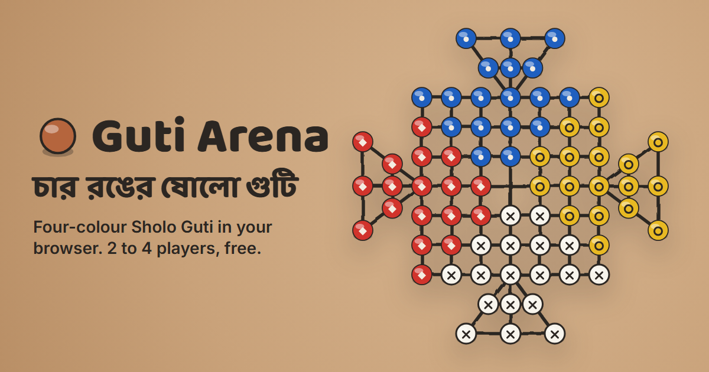

# Guti Arena

**Play four-colour Sholo Guti (ষোলো গুটি) in your browser, free.**

Play now at **[guti.rakibhasansohag.com](https://guti.rakibhasansohag.com)**.

Sholo Guti is the board game people scratch into the courtyard dirt across Bangladesh and eastern India, with pebbles or seeds for pieces. Guti Arena is the four-colour version: a triangle for each player and 18 pieces a side. No sign-up, no ads, no betting. Bangla first, English too.



## Ways to play

- **Against the computer.** Pick Easy, Medium or Hard for any seat.
- **On one phone or tablet.** Two to four friends pass the device round the table.
- **Online with friends.** Make a private room, send the link or the 5-letter code, and fill any empty seat with a computer player. Each turn has 30 seconds; if someone drops out, the computer covers their seat until they come back.

## Rules in a minute

1. Each player has 18 pieces of one colour: blue, yellow, white or red. Each colour also has a mark (dot, ring, cross, diamond), so you can tell them apart without colour.
2. On your turn, move one piece one step along a line to an empty point.
3. To capture, jump over a rival piece to the empty point right behind it, along one straight line. You may keep jumping with the same piece, or stop.
4. A colour with no pieces left is out. The last colour on the board wins. If 40 rounds pass with no capture, the colour with the most pieces wins.

The full rules, with pictures, are at [guti.rakibhasansohag.com/how-to-play](https://guti.rakibhasansohag.com/how-to-play).

## Run it yourself

You need Node 24 and pnpm 10.

```bash
pnpm install
pnpm dev
```

The game opens at http://localhost:5173. The online-room server runs alongside it on port 8787.

| Command          | What it does                            |
| ---------------- | --------------------------------------- |
| `pnpm dev`       | Start the game and the room server      |
| `pnpm build`     | Build the site for production           |
| `pnpm test`      | Run the rules, AI and room-server tests |
| `pnpm lint`      | Check code style and file names         |
| `pnpm typecheck` | Check TypeScript types                  |
| `pnpm format`    | Format the code                         |

### What's inside

| Folder    | What                                                                     |
| --------- | ------------------------------------------------------------------------ |
| `engine/` | The board, the rules and the computer players, shared by site and server |
| `web/`    | The site: React, Tailwind CSS and Motion                                 |
| `worker/` | The Cloudflare Worker that serves the site and runs each online room     |
| `docs/`   | The design system (`DESIGN.md`)                                          |

## Credits

Made by Rakib Hasan Sohag.

Sounds from [Kenney](https://kenney.nl) and the ground texture from [Poly Haven](https://polyhaven.com), both CC0.

## License

The code is MIT. The "Guti Arena" name, logo, artwork and sounds made for this project are reserved. See [LICENSE](LICENSE).
